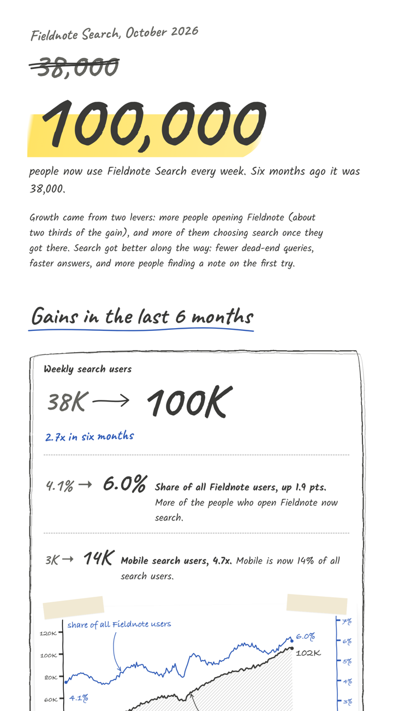

# Sketchbook Newsletter

An agent skill that turns a milestone or metrics update into a newsletter that looks hand-drawn:
pencil-wobbly boxes, a highlighter on the hero number, the old number struck through, ink arrows,
ticks, a taped-in pencil chart, and a "thank-you village" of doodled houses. Every number stays
exact.



[Full example page](examples/fieldnote-100k/preview.png) · [HTML](examples/fieldnote-100k/newsletter.html) · [Data](examples/fieldnote-100k/data.csv)
(fictional product, synthetic data)

## Why

Templated dashboards get skimmed. A page that looks drawn for this one moment gets read, and it
makes a team milestone feel like a celebration rather than a report.

## How it works

- **Handwriting:** Caveat for display text and Kalam for body text, both from Google Fonts.
- **Pencil boxes:** irregular `border-radius`, run through an SVG `feTurbulence` +
  `feDisplacementMap` filter, plus a faint offset second stroke.
- **Highlighter:** a skewed gradient behind the bottom of the hero number.
- **Doodles:** arrows, ticks and houses are reusable SVG `<symbol>`s.
- **Chart:** `matplotlib` in xkcd mode with a handwriting font, hatched fill and arrow
  annotations, exported as a transparent PNG and "taped" onto the page.
- **Email:** clients strip web fonts and SVG, so `export_email.py` renders the page and slices it
  into PNGs at blank gaps, ready to paste into Outlook or Gmail.

## Use it

Install as a skill for Claude Code or GitHub Copilot:

```bash
git clone https://github.com/rohitjz/sketchbook-newsletter ~/.claude/skills/sketchbook-newsletter
# or ~/.copilot/skills/sketchbook-newsletter
```

Then ask: *"Make a sketchbook newsletter celebrating 100K weekly users"* and share your numbers.

Or run the pieces yourself:

```bash
pip install -r requirements.txt
python scripts/sketch_chart.py examples/fieldnote-100k/data.csv --date date \
  --primary weekly_users --secondary share_of_base \
  --primary-label "Fieldnote Search weekly users" \
  --secondary-label "share of all Fieldnote users" \
  --out examples/fieldnote-100k/chart.png
python scripts/export_email.py examples/fieldnote-100k/newsletter.html --slices 4
```

Needs Python 3.9+ and Chrome or Edge, which is used for the headless render.

## Files

```
SKILL.md                     instructions the agent follows
assets/template.html         the page: CSS, SVG symbols, {{PLACEHOLDERS}}
scripts/sketch_chart.py      CSV/XLSX -> pencil-style dual-axis chart (transparent PNG)
scripts/export_email.py      HTML -> email-safe PNG slices + paste page
examples/fieldnote-100k/     complete worked example
```

## License

MIT
